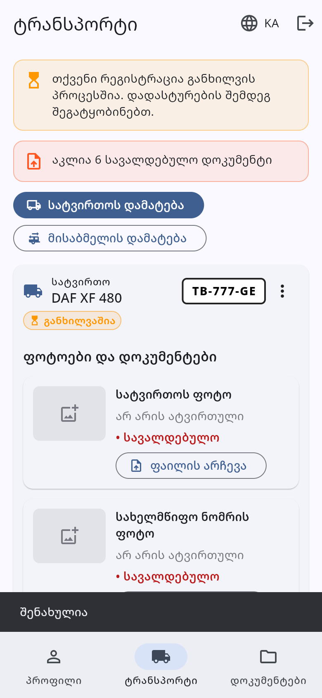

# Truck Transport – Driver Registration

One app for **Android, iOS, Windows, macOS and web** where truck drivers register, fill in their personal details, add their trucks and trailers, and upload documents and photos (driver's license, passport, truck photo, license plate, registration…). An admin panel lets reviewers approve or reject drivers and each document.

Languages: **English, Русский, ქართული, Türkçe** (switchable in the app, defaults to the device language).



## Download the app

Every change to `main` is built automatically. Get the newest version from the [Latest build](../../releases/tag/latest) release:

- **Android:** download `TruckTransport-android.apk` on the phone and open it (allow "install unknown apps" when asked).
- **Windows:** download `TruckTransport-windows.zip`, unzip it and run `truck_driver_app.exe`.

iPhone and Mac builds need an Apple developer account and are not set up yet.

## What's inside

| Folder | Contents |
|---|---|
| `app/` | Flutter app (driver screens + admin panel in one app) |
| `supabase/schema.sql` | Database tables, security rules and private file storage for Supabase |
| `docs/screenshots/` | Screenshots of the main screens |

## Try it without a server (preview mode)

```bash
cd app
flutter pub get
flutter run -d chrome        # or: -d windows / -d macos / an Android or iOS device
```

The app connects to the project's Supabase server (settings in `app/lib/config.dart`). Add `--dart-define=DEMO=true` to start in **preview mode** instead with sample drivers. Any phone number and SMS code work, and "Open the admin panel" shows the reviewer view. Nothing is saved.

## Connect to Supabase

1. Create a free project at [supabase.com](https://supabase.com).
2. In the project's **SQL Editor**, run `supabase/schema.sql`.
3. **Authentication → Providers**: enable *Email*, and *Phone* with an SMS provider (for example Twilio) for SMS codes.
4. Make yourself an admin: sign up once in the app, then in the SQL Editor run
   `insert into admins (user_id) values ('<your user id from Authentication → Users>');`
5. Put your project's URL and publishable key in `app/lib/config.dart`, or pass them when running:

```bash
flutter run --dart-define=SUPABASE_URL=https://xxxx.supabase.co --dart-define=SUPABASE_ANON_KEY=your-publishable-key
```

Never put the `service_role` key in the app.

## Adding new document types

Document types live in the `document_types` table with labels in all four languages. Add a row (Supabase → Table Editor) and the app shows it on next launch, with no new app release needed.

## Translations

UI texts are in `app/lib/l10n/app_en.arb`, `app_ru.arb`, `app_ka.arb`, `app_tr.arb`. After editing run `flutter gen-l10n`.
